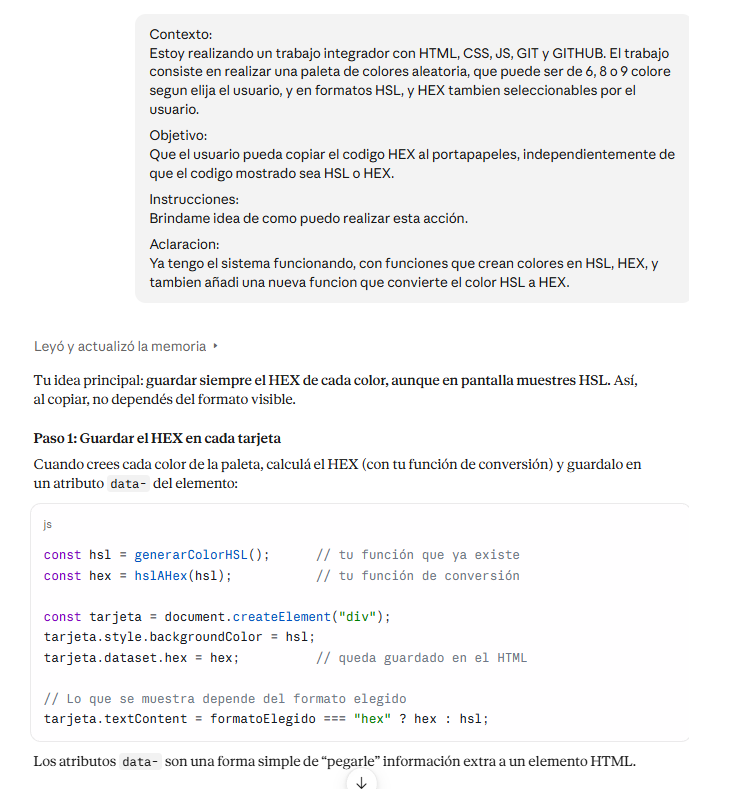
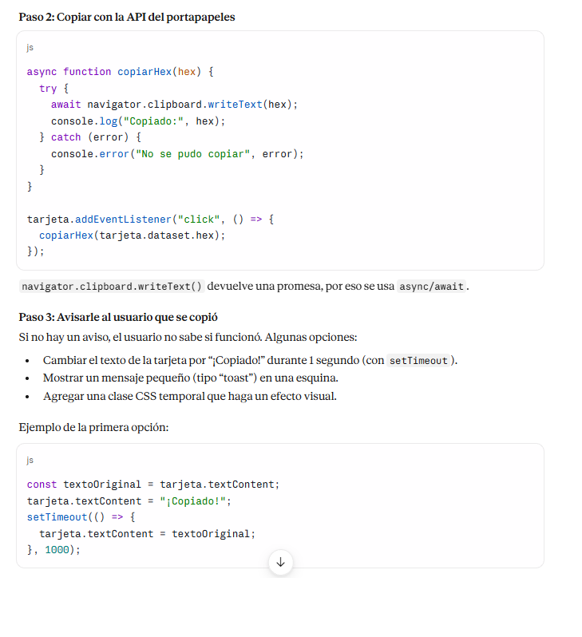
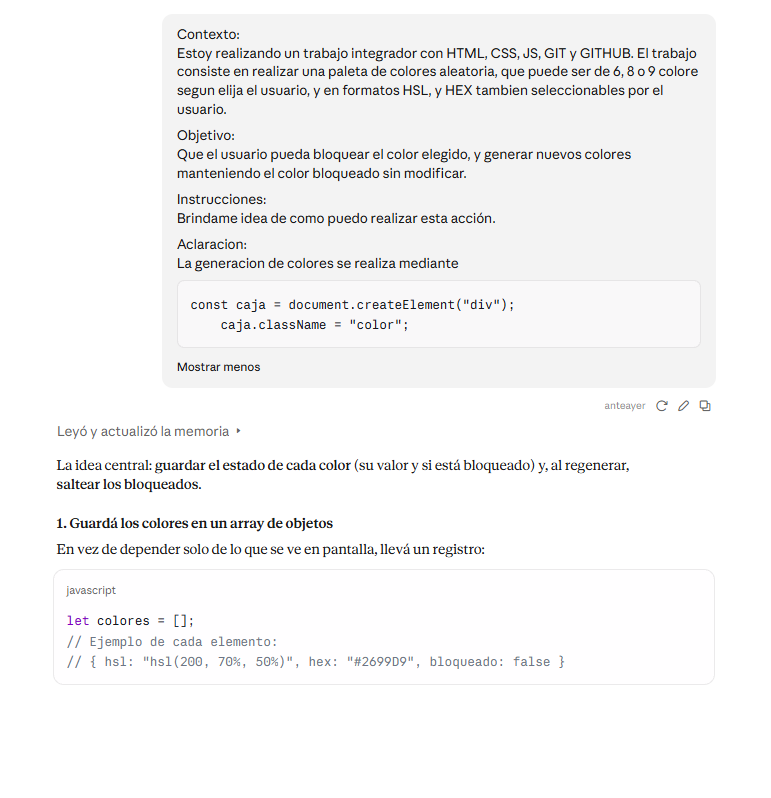
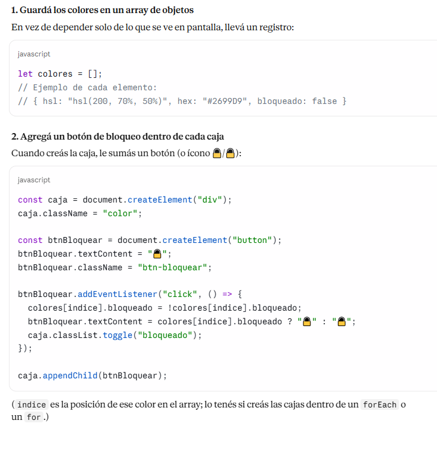
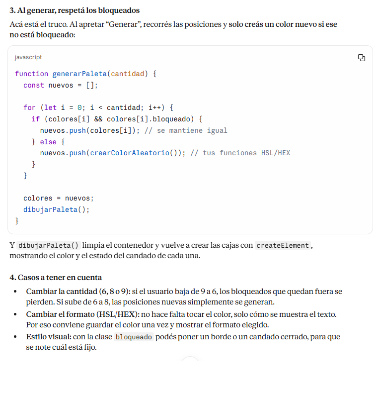
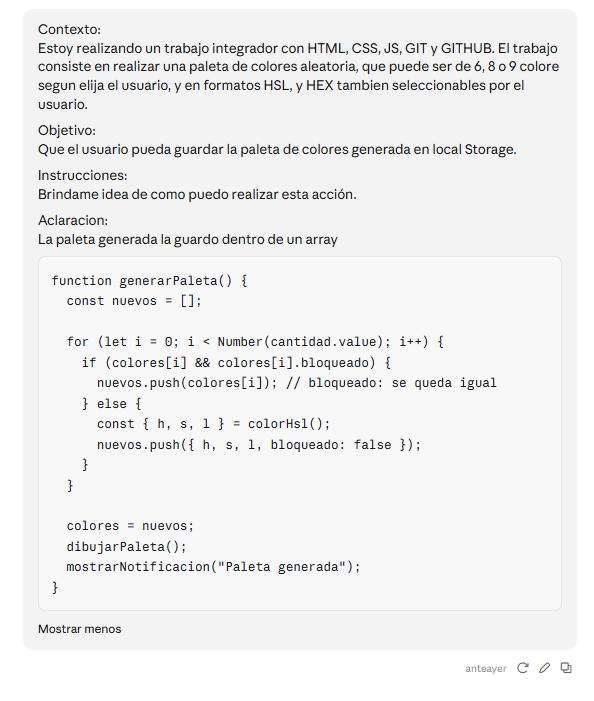
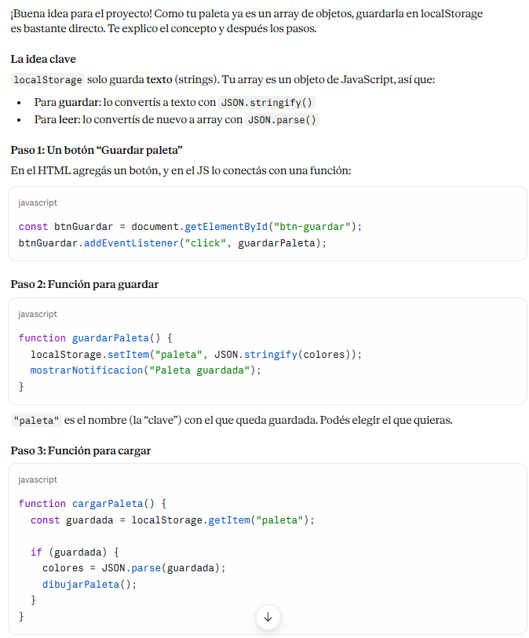
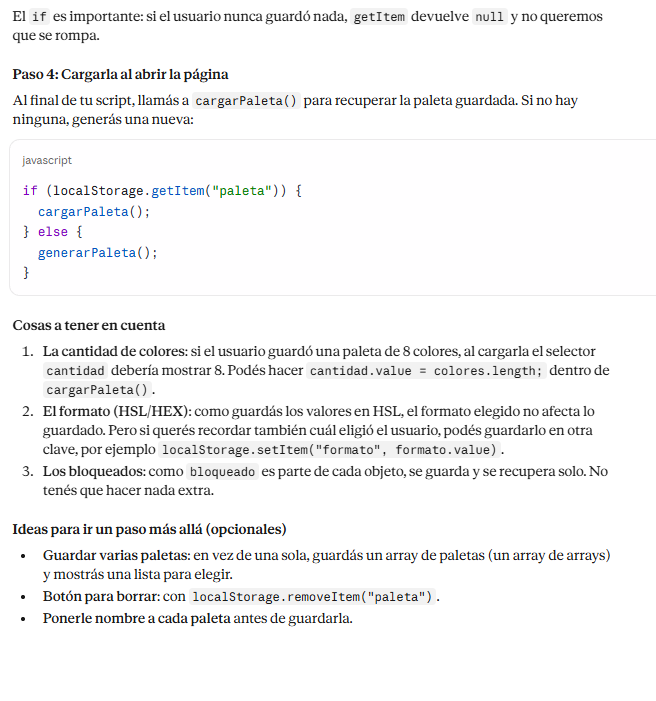

# Prompts utilizados con IA – Colorfly Studio

Este documento registra los prompts que usé con una herramienta de IA (Claude) durante el desarrollo de Colorfly Studio, mi proyecto integrador del Módulo 1.

El objetivo es mostrar cómo usé la IA como apoyo para aprender, qué le pedí, qué obtuve y qué entendí/modifiqué yo.

## 📌 Cómo usé la IA
- Como ayuda para entender conceptos que todavía estaba aprendiendo.
- Para resolver errores y mejorar mi código.
- Siempre leí, probé y adapté las respuestas antes de usarlas en el proyecto.

## 📝 Registro de prompts

### 1. Conversión de colores (HSL → HEX)
**Qué necesitaba:** copiar el código HEX al portapapeles aunque en pantalla se muestre HSL.

**Prompt:**

**Qué obtuve:** una función que convierte HSL a HEX.

**Qué hice yo con eso:** la integré como `hslAHex(h, s, l)` y la uso en todo el proyecto: para pintar el fondo de cada color, para calcular el color del texto (`colorDeTexto`, que necesita un HEX) y para copiar el código al portapapeles con `copiarHex`. Así, aunque el usuario elija ver HSL, siempre se copia un HEX. Entendí que HSL se pasa a valores de rojo, verde y azul, y que cada uno se convierte a hexadecimal con `toString(16)`.

**Archivo:** app.js

---

### 2. Bloquear un color de la paleta
**Qué necesitaba:** que un color bloqueado se mantenga al generar una paleta nueva.

**Prompt:**

**Qué obtuve:** una forma de guardar la paleta como array de objetos `{h, s, l, bloqueado}`.

**Qué hice yo con eso:** lo adapté a mi forma de crear los colores con `createElement`. Guardé la paleta en el array `colores` y, en `generarPaleta`, recorro las posiciones: si el color está bloqueado lo conservo, y si no, genero uno nuevo con `colorHsl()`. Después separé el dibujo en `dibujarPaleta` y agregué un botón por color que cambia `c.bloqueado`, actualiza el ícono (🔒/🔓) con `actualizarBotonBloqueo` y agrega la clase CSS `bloqueado`. También sumé `aria-label` y `aria-pressed` para accesibilidad.

**Archivo:** app.js

---

### 3. Guardar paletas en localStorage (máximo 5)
**Qué necesitaba:** guardar la paleta, mostrar las guardadas y poder cargar una; si hay más de 5, se borran las más antiguas.

**Prompt:**

**Qué obtuve:** explicación y código para usar localStorage con un límite de 5 paletas.

**Qué hice yo con eso:** lo dividí en funciones chicas, cada una con una sola tarea: `obtenerPaletas` (lee y convierte con `JSON.parse`, con `try/catch` por si el dato está dañado), `guardarPaleta` (agrega la paleta con un `id` y borra las más antiguas con `shift()` si se pasa del máximo), `mostrarPaletasGuardadas` (dibuja las muestras con botones Cargar y Eliminar), `cargarPaletaGuardada` y `eliminarPaleta`. Dejé el límite en una constante, `MAXIMO_PALETAS`, para poder cambiarlo fácil. Al cargar una paleta, los colores vuelven con `bloqueado: false`. Aprendí que localStorage solo guarda texto, por eso uso `JSON.stringify` y `JSON.parse`.

**Archivo:** app.js